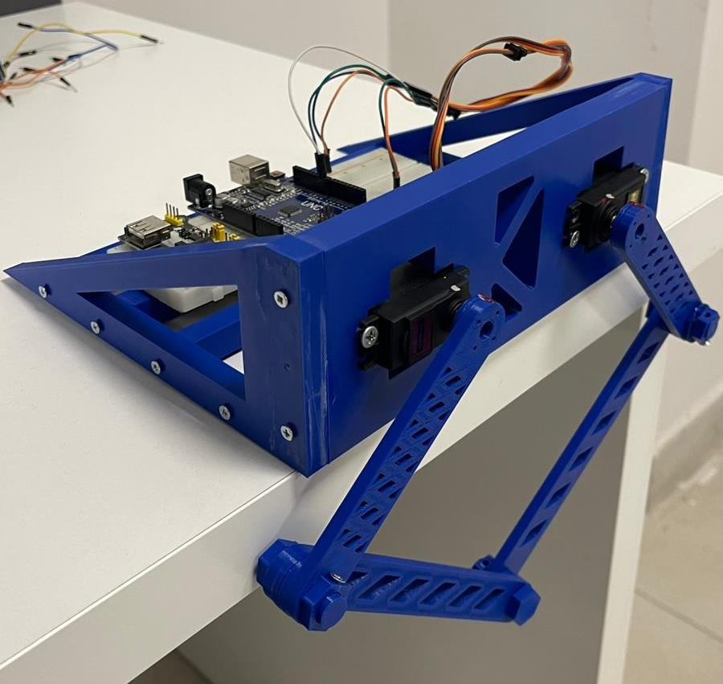
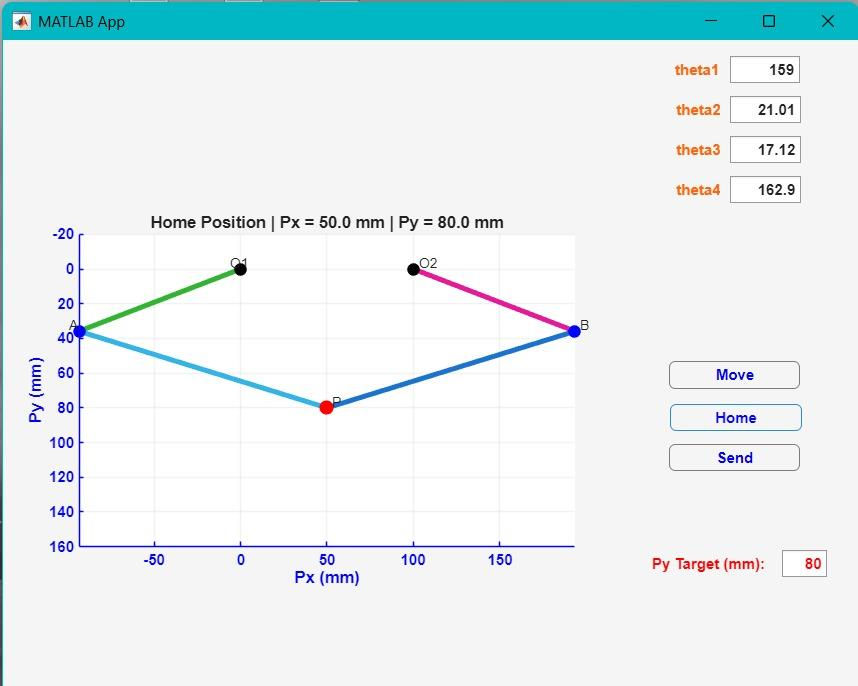
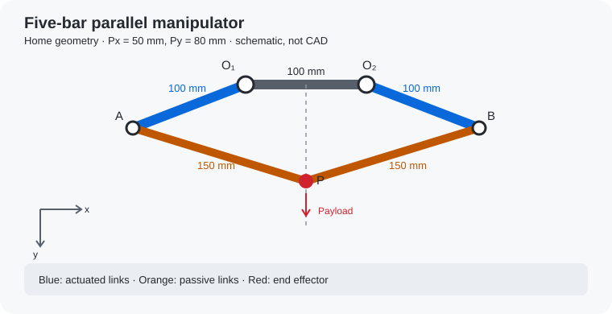
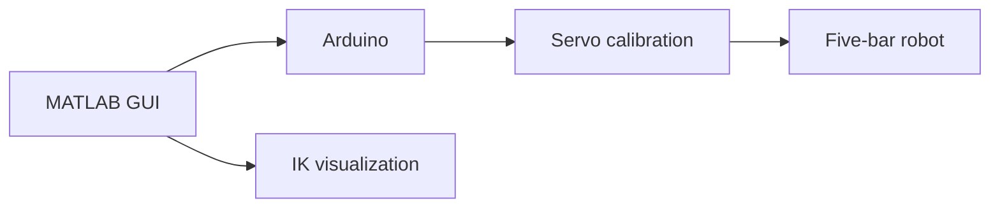
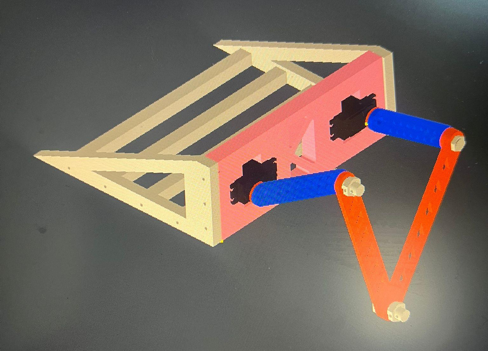
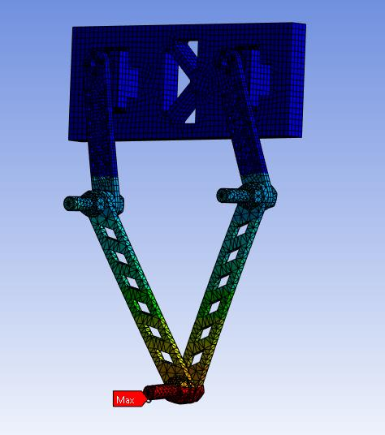

# Five-Bar Parallel Robot

**MATLAB · Arduino · Inverse Kinematics · Motion Control**

A 2-DOF planar parallel manipulator developed as a team project for MEE312 – Mechanism Design II at İzmir Kâtip Çelebi University.

**Project development:** March–May 2026 · **Academic year:** 2025–2026 · **GitHub publication:** November 2026

  
  

## My contribution

**Control System Development**

- MATLAB App Designer interface and inverse kinematics visualization
- MATLAB–Arduino serial communication
- Servo calibration, linear interpolation and incremental motion

## Mechanism and control

Two base-mounted servos drive the active links; two passive links meet at the end effector.

| Specification | Value |
| --- | --- |
| Mechanism | 2-DOF five-bar |
| Actuators | 2 × MG995 |
| Motor spacing / drive / passive links | 100 / 100 / 150 mm |
| Vertical command range | 80–120 mm |
| Design payload | 50 g |

## Project gallery

  
  

[More project images](media/) · [Electronics](media/electronic-control-circuit.jpeg)

## Repository

| Folder | Contents |
| --- | --- |
| [control/](control/) | Original MATLAB apps, archived parameters and reconstructed offline simulation |
| [software/](software/) | Arduino firmware |
| [cad/](cad/) | STEP and Inventor mechanical models |
| [media/](media/) | Prototype, GUI and FEA images |
| [docs/](docs/) | Technical notes |

## Quick start

For an offline MATLAB preview, add `control/reconstructed` to the MATLAB path and run `fivebar_demo`. The reconstructed helpers are new portfolio additions, not original project source. The archived v2 app may send HOME over serial at startup; disconnect hardware before opening it for inspection.

[Control implementation notes](docs/control-implementation.md) · [File inventory](FILE_INVENTORY.md)

## Reference

[F. C. Can, Arduino Based Planar Two DoF Robot Manipulator (2018)](https://doi.org/10.17265/2159-5275/2018.03.002)

**Status:** Team prototype documented. Hardware performance and MATLAB/Inventor runtime compatibility have not been retested.
