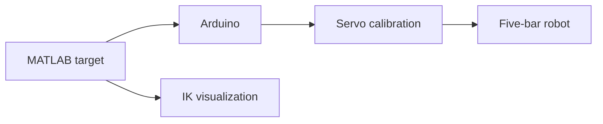

# Five-Bar Parallel Robot

**MATLAB · Arduino · Inverse Kinematics · Motion Control**

A 2-DOF planar parallel manipulator developed as a team project for MEE312 – Mechanism Design II, İzmir Kâtip Çelebi University (May 2026).

## Mechanism

Two base-mounted servos actuate the blue links. The two passive links meet at the end effector. Inverse kinematics calculates the joint configuration for a desired Cartesian target.

## My contribution

**Control System Development**

- MATLAB App Designer interface and kinematic visualization
- MATLAB–Arduino serial communication
- Servo calibration, linear interpolation and incremental motion

| Specification | Value |
| --- | --- |
| Mechanism | 2-DOF five-bar |
| Actuators | 2 × MG995 |
| Motor spacing / drive / passive links | 100 / 100 / 150 mm |
| Vertical command range | 80–120 mm |
| Design payload | 50 g |
| CAD / FEA (team) | Inventor / ANSYS |

## Explore

- [Original Arduino firmware](software/sketch_may1a/sketch_may1a.ino)
- [MATLAB offline simulation](control/reconstructed/fivebar_demo.m) — reconstructed demonstration
- [Inverse kinematics](control/reconstructed/fivebarIK_project.m) — reconstructed helper
- [Technical notes and test details](docs/control-implementation.md)

To preview the mechanism without hardware, add `control/reconstructed` to the MATLAB path and run `fivebar_demo`. The reconstructed helpers are new portfolio additions, not original project source.

## References

- [F. C. Can, Arduino Based Planar Two DoF Robot Manipulator (2018)](https://doi.org/10.17265/2159-5275/2018.03.002)
- [MathWorks – Perform Forward and Inverse Kinematics on a Five-Bar Robot](https://www.mathworks.com/help/sm/ug/five-bar-robot.html)

**Status:** Physical team prototype documented. Original Arduino source published; App Designer archives, CAD and team photographs are prepared for manual upload. Hardware performance and MATLAB runtime have not been retested.
