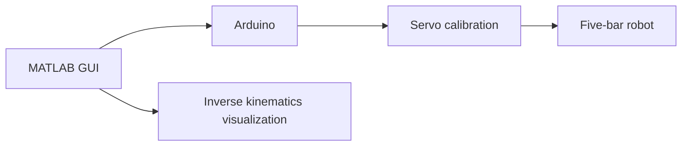

# Five-Bar Parallel Robot

**MATLAB · Arduino · Inverse Kinematics · Motion Control**

A 2-DOF planar parallel robot developed as a team project for MEE312 – Mechanism Design II at İzmir Kâtip Çelebi University (May 2026).

## My contribution

**Control System Development**

- MATLAB App Designer interface and kinematic visualization
- MATLAB–Arduino serial communication
- Servo calibration, linear interpolation and motion commands

## System overview

| Specification | Value |
| --- | --- |
| Mechanism | 2-DOF five-bar |
| Actuators | 2 × MG995 servos |
| Vertical command range | 80–120 mm |
| Design payload | 50 g |
| CAD / FEA (team) | Inventor / ANSYS |

## Documentation

- [Control implementation and technical notes](docs/control-implementation.md)
- [Kinematic reference paper](https://doi.org/10.17265/2159-5275/2018.03.002)

**Status:** Physical team prototype documented; archived source files and photographs are pending publication review. End-effector positioning accuracy has not been independently verified.
