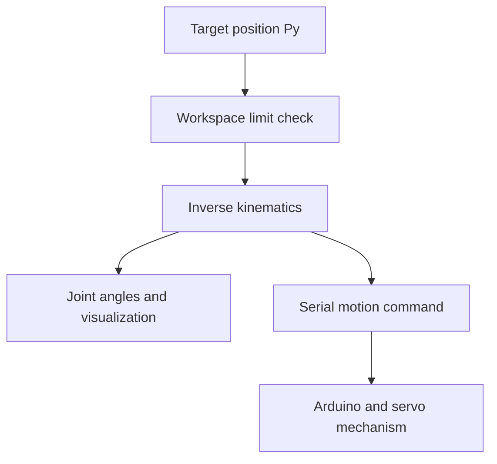

# Five-Bar Parallel Robot

A university mechatronics engineering team project involving a planar five-bar (5R) parallel manipulator, MATLAB-based motion commands, inverse kinematics and Arduino serial communication.

**My role:** Control system development.

## Control system

The supplied MATLAB App Designer applications provide a graphical interface for entering a target position, calling an inverse kinematics solver, displaying four joint angles, visualizing the mechanism and sending motion commands to an Arduino.



## Technologies

- MATLAB App Designer (R2025b)
- Arduino serial communication (9600 baud)
- Inverse kinematics and planar parallel mechanisms
- Autodesk Inventor 2026 / STEP mechanical assembly

## Recorded control configuration

| Parameter | GUI v2 |
| --- | --- |
| Fixed horizontal target, Px | 50 mm |
| Home position, Py | 80 mm |
| Allowed vertical target, Py | 80–120 mm |
| Serial baud rate | 9600 |
| Home command | `HOME` |
| Motion command | `Y:<target>` |

The earlier GUI and saved MATLAB workspace use different vertical target limits (30–140 mm). These are separate development configurations; the final physical workspace has not yet been verified.

## Repository roadmap

```text
SCARA-Robot/
├── README.md
├── control/       # MATLAB applications and kinematics
├── software/      # Arduino firmware
├── cad/           # Mechanical assembly
├── docs/          # Technical documentation
└── media/         # Project photographs and demonstrations
```

## Current status

Documentation in progress. The supplied applications refer to external functions `fivebarIK_project` and `drawFivebarOnAxes`; their implementations and the Arduino firmware are not included in the files reviewed so far. Hardware performance and closed-loop feedback have not been verified. Original team files will be added only after checking publication permissions.

