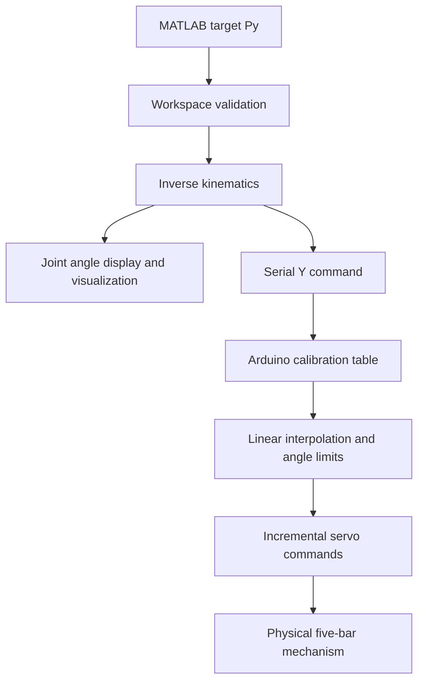

# Five-Bar Parallel Robot | MATLAB & Arduino

A two-degree-of-freedom (2-DOF) planar parallel manipulator developed as a team project for **MEE312 – Mechanism Design II**, İzmir Kâtip Çelebi University, May 2026.

**My role: Control system development.**

## Project overview

The team designed and manufactured a vertical five-bar mechanism for a specified 50 g end-effector payload. The project combines inverse kinematics, CAD, structural analysis, a MATLAB graphical interface and Arduino-based servo actuation.

## Control system

My area of responsibility was the control system. The available project files document:

- MATLAB App Designer interface for target position entry, inverse kinematics visualization and joint-angle display.
- Serial communication between MATLAB and Arduino.
- Experimental servo calibration and piecewise linear interpolation.
- Workspace and servo-angle constraints.
- Incremental servo motion and a predefined home position.



The reviewed firmware receives the desired vertical coordinate rather than the theoretical joint angles during normal motion. MATLAB computes the kinematic configuration for visualization, while the Arduino maps the target coordinate to experimentally calibrated servo commands.

[Detailed control implementation and review notes](docs/control-implementation.md)

## Design specifications

| Parameter | Value |
| --- | --- |
| Mechanism | 2-DOF planar five-bar |
| Motor spacing | 100 mm |
| Drive links | 100 mm |
| Connecting links | 150 mm |
| Required payload | 50 g |
| Required horizontal workspace | 25–50 mm |
| Implemented GUI v2 horizontal coordinate | 50 mm (fixed) |
| Vertical command range | 80–120 mm |
| Actuators | 2 × MG995 servos |
| Controller | Arduino Uno |
| Serial baud rate | 9600 |
| Servo output pins | D9, D10 |
| Home servo commands | 90°, 90° |
| Incremental motion delay | 20 ms |

## Experimental calibration

The following calibration points are stored in the supplied Arduino firmware. They are command values, not independently verified position measurements.

| Target Py (mm) | Left servo (°) | Right servo (°) |
| ---: | ---: | ---: |
| 80 | 90 | 90 |
| 105 | 95 | 85 |
| 115 | 100 | 80 |
| 120 | 102 | 78 |

The firmware interpolates between adjacent calibration points and constrains servo commands to their configured ranges.

### Serial protocol

| Command | Function |
| --- | --- |
| `HOME` | Request home position |
| `Y:105` | Request a vertical target of 105 mm |
| `A:95,85` | Request manual servo commands |

## Team mechanical work

The project report documents Autodesk Inventor CAD, PLA 3D-printed structural parts, ANSYS structural analysis and a manufactured physical prototype. These are team achievements, not claims of individual authorship.

## Repository roadmap

```text
control/     # MATLAB applications and kinematics
software/    # Arduino firmware
cad/         # Mechanical assembly and parts
docs/        # Project documentation
media/       # Prototype and GUI images
```

## References

- F. C. Can, "Arduino Based Planar Two DoF Robot Manipulator," Journal of Mechanics Engineering and Automation, vol. 8, pp. 110–117, 2018. DOI: [10.17265/2159-5275/2018.03.002](https://doi.org/10.17265/2159-5275/2018.03.002).
- F. C. Can and H. Şen, "Real time controlled two dof five bar robot manipulator," International Symposium of Mechanism and Machine Science, 2017.

## Status and limitations

- The team report documents a physical prototype; no new hardware test or accuracy measurement has been performed for this repository.
- The reviewed Arduino code does not implement end-effector feedback or a PID controller. The servo calibration is open-loop at the system level.
- The archived MATLAB GUI v2 depends on external functions `fivebarIK_project` and `drawFivebarOnAxes`, which have not yet been recovered. Its serial port configuration is machine-specific.
- Earlier development files use different workspace limits and serial commands; they should not be treated as equivalent to the reviewed firmware.
- Original team files and photographs are not yet published pending permission review.
